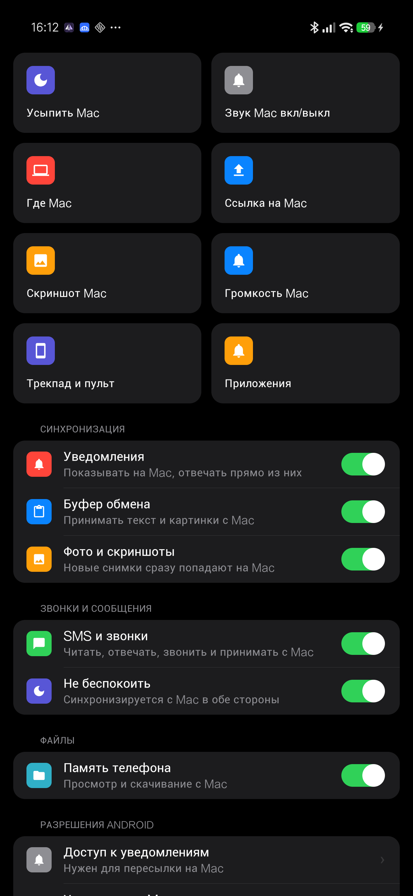
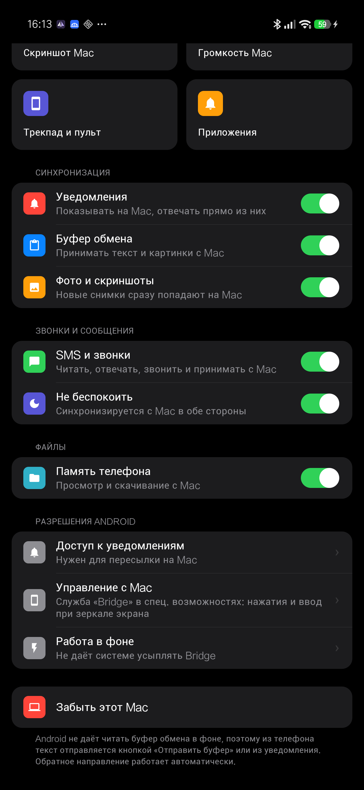

# Bridge — Android ⇄ Mac

Небольшая «экосистема» для связки Android-телефон + Mac в одной Wi-Fi сети:

* **сопряжение по коду** (6 цифр, сверяются на обоих экранах);
* **передача файлов** в обе стороны (кнопка, меню «Поделиться» на телефоне, меню-бар на Mac);
* **общий буфер обмена**: Mac → телефон автоматически, телефон → Mac по нажатию (см. ограничения);
* **уведомления телефона на Mac**, включая отзыв уведомления, когда вы смахнули его на телефоне;
* **ответ на уведомления с Mac** (мессенджеры и всё, что поддерживает быстрый ответ) и «закрыть на телефоне»;
* **SMS и звонки на Mac**: входящее SMS с ответом прямо из уведомления, входящий звонок с кнопками «Ответить» / «Сбросить», управление разговором из меню (завершить, громкая связь, микрофон);
* **автоотправка новых фото и скриншотов** в `Изображения/Bridge` на Mac;
* **статус телефона** (заряд, сеть) в меню Mac, **«найти телефон»** (громкий сигнал) и управление музыкой/громкостью;
* **звонок с Mac**: набрать номер или выбрать контакт, «Последние звонки» — перезвонить в один клик;
* **буфер: история и картинки** — последние 10 записей в меню Mac; картинки копируются между устройствами;
* **файлы телефона на Mac**: окно «Файлы телефона…» (просмотр и скачивание, только чтение);
* **окно Bridge на Mac и экран на телефоне** в стиле Apple HIG (системные материалы, SF Symbols, анимации, которые отключаются при «Уменьшить движение»); файлы можно перетащить прямо в окно;
* **новое SMS с Mac**: окно с выбором контакта и подменю «Ответить на SMS»;
* **«Не беспокоить»**: режим телефона приглушает уведомления на Mac, а Фокус на Mac (при полном доступе к диску) включает режим на телефоне;
* **ссылки как Handoff**: «Открыть ссылку на телефоне…» в меню Mac; ссылка, которой вы делитесь на телефоне, приходит на Mac уведомлением; уведомления о низком заряде телефона;
* **зеркало экрана телефона с управлением**: окно на Mac, нажатия мышью, прокрутка, ввод с клавиатуры, кнопки «Назад / Домой / Недавние»;
* **телефон как трекпад, клавиатура и медиапульт для Mac** (Mac попросит разрешение «Универсальный доступ»); **выбор приложений**, чьи уведомления идут на Mac; заряд Mac на главном экране телефона; поиск по SMS;
* **щипок трекпадом в зеркале** масштабирует экран телефона; **«Сбросить и написать SMS»** в уведомлении о звонке (текст настраивается в меню);
* **окно «Сообщения»**: переписки SMS с историей и ответом, как в «Сообщениях»; **звук телефона в зеркале** (музыка, видео, игры; звонки Android не отдаёт);
* **«Найти Mac» и «Заблокировать Mac»** с телефона и плитка «Буфер → Mac» в шторке быстрых настроек;
* **Без общей сети (Bluetooth LE)** — как в Continuity: телефон анонсируется по BLE, Mac находит его и подключается; уведомления, SMS, буфер и команды идут по Bluetooth, зеркало и файлы переходят на Wi-Fi сами. Для Wi-Fi ⇄ кабель есть автопоиск по подсети без mDNS, фиксированный порт 47653 и автосопряжение, если Mac один.
* **«Не беспокоить» в обе стороны** — режим телефона глушит баннеры Bridge на Mac; чтобы он включал настоящий Focus, создайте в «Быстрых командах» две команды «Bridge Focus On» и «Bridge Focus Off» (действие «Задать Focus»). Focus Mac → телефон читается через системное разрешение «Конфиденциальность → Focus» (Full Disk Access не нужен).
* **«Поделиться» на Mac**: пункт «Bridge → телефон» в меню «Поделиться», в Services («Отправить на телефон (Bridge)»)
  и перетаскивание файлов на значок в строке меню.

* **Теперь в экосистеме ещё**: «Где Mac» (положение Mac на карте), «Скриншот Mac» на телефон, громкость и звук Mac, «Усыпить Mac» и пробуждение по сети, «Ссылка на Mac», проложить маршрут с Mac на телефоне, «Что играет» на Mac, календарь и будильник телефона в меню Mac, снимок с камеры телефона на Mac, звук звонка телефона из меню, открыть вкладку браузера на телефоне, скриншот области → телефон, автоблокировка Mac, когда телефон ушёл, четыре плитки быстрых настроек (заблокировать, где, найти, звук) и уведомление о низком заряде Mac.

Всё работает по локальной сети, без облака и аккаунтов. Трафик зашифрован (ECDH P-256 + AES-256-GCM), подробности —
в [docs/PROTOCOL.md](docs/PROTOCOL.md).

> Это не AirDrop и не Quick Share: протокол собственный, поэтому нужны оба приложения из этого проекта.
> Родная панель AirDrop на Mac не может показать произвольный телефон: она видит только устройства Apple и
> Android-телефоны с поддержкой совместимости Quick Share ↔ AirDrop от Google (пока не все производители,
> Xiaomi — в планах). Поэтому Bridge добавляет собственный пункт в меню «Поделиться».

## Скриншоты

<p>
  
  
</p>

## Состав

| Папка | Что внутри |
|---|---|
| `android/` | Приложение Android (Kotlin, minSdk 29) и модуль `core` — протокол на чистом Kotlin/JVM |
| `mac/` | Меню-бар приложение для macOS 13+ (Swift, AppKit, Network.framework) и пакет `BridgeCore` |
| `reference/` | Эталонная реализация протокола на Python + тесты + генератор тестовых векторов |
| `vectors/` | Общие тестовые векторы для Kotlin и Swift |
| `docs/` | Описание протокола |

## Сборка

### Mac

Нужны Xcode или Command Line Tools (Swift 5.9+).

```bash
cd mac
./build.sh            # соберёт mac/Bridge.app (подписывается ad-hoc)
open Bridge.app
```

Чтобы получить установочный образ: `./make-dmg.sh` → `mac/Bridge.dmg` (перетащите Bridge в Applications).

`build.sh` собирает и расширение для меню «Поделиться». Его нужно включить один раз:
Системные настройки → Конфиденциальность и безопасность → Расширения → Общий доступ → «Bridge → телефон».
Services-пункт появляется после перезапуска Finder/выхода-входа (`pbs -update` выполняется сборкой).

При первом запуске macOS спросит доступ к локальной сети и разрешение на уведомления — разрешите оба.
Приложение живёт в строке меню (значок телефона). Тесты ядра: `swift test`.

### Android

Нужен Android Studio (или JDK 17 + Android SDK 35).

1. Откройте папку `android/` в Android Studio, дождитесь синхронизации Gradle.
2. Запустите `app` на телефоне (включите отладку по USB) или соберите APK: `./gradlew :app:assembleDebug`
   → `app/build/outputs/apk/debug/app-debug.apk`.
3. Тесты протокола (без Android SDK): `./gradlew :core:test` — часть из них запускает `reference/bridge_ref.py`
   и требует `python3` с пакетом `cryptography`.

## Первое подключение

1. Телефон и Mac — в одной Wi-Fi сети.
2. На Mac: значок Bridge в строке меню → **«Сопрячь телефон…»** (режим сопряжения включается на 2 минуты).
3. На телефоне: **Bridge → «Сопрячь с Mac»** → выберите Mac. Если Mac не найден, нажмите «Ввести адрес вручную» и
   введите `адрес:порт` из меню Bridge на Mac.
4. На обоих устройствах появится код из 6 цифр. Если он совпадает — подтвердите на **обоих**.
5. Дайте приложению на телефоне доступ к уведомлениям («Доступ к уведомлениям») и, желательно, отключите
   оптимизацию батареи — иначе Android может усыпить соединение.

## Как пользоваться

* **Файл на Mac:** на телефоне «Поделиться» → «Отправить на Mac» (или кнопка в приложении). Файлы попадают в
  `Загрузки/Bridge` на Mac.
* **Файл на телефон:** меню Bridge → «Отправить файл на телефон…». Файлы попадают в `Download/Bridge` на телефоне.
* **Буфер Mac → телефон:** копируете на Mac — текст сразу оказывается в буфере телефона.
* **Буфер телефон → Mac:** копируете на телефоне и нажимаете **«Буфер → Mac»** в постоянном уведомлении Bridge
  (или текст через «Поделиться»).
* **Уведомления:** приходят на Mac автоматически; отключаются переключателями на обеих сторонах. Кнопки «Ответить» и
  «Закрыть на телефоне» видны при наведении на баннер (или если в настройках уведомлений Bridge выбран стиль «Предупреждения»).
* **Фото:** на телефоне включите «Автоотправка новых фото и скриншотов» (нужно разрешение на фото). Отправляются только
  снимки, сделанные после включения; пока телефон не в сети, они догонят позже.
* **SMS и звонки:** на телефоне включите «SMS и звонки на Mac» (разрешения: SMS, контакты, телефон, журнал вызовов).
* **Найти телефон:** меню Bridge → «Найти телефон» — сигнал на максимальной громкости (даже в беззвучном режиме)
  до выключения или 2 минут; выключить можно и на самом телефоне.
* **Разговор через Mac невозможен:** Android не отдаёт сторонним приложениям звук сотового звонка, а macOS не умеет работать гарнитурой Bluetooth HFP, поэтому Bridge управляет звонком (ответить, сбросить, громкая связь), но говорить нужно в телефон.
* **Звонок с Mac:** меню Bridge → «Позвонить с телефона…» (номер или контакт) или «Последние звонки». Нужны «SMS и звонки на Mac»
  и разрешение «Телефон» на телефоне.
* **Буфер:** «История буфера» — последние 10 текстов. Картинка, скопированная на Mac (в т. ч. скриншот в буфер),
  уходит на телефон файлом, а картинка, скопированная на телефоне, отправляется кнопкой «Буфер → Mac»
  и попадает в буфер Mac. Отправку картинок можно выключить в меню Mac.
* **Файлы телефона:** на телефоне включите «Файлы телефона на Mac» и выдайте «доступ ко всем файлам»; на Mac — «Файлы телефона…».
  Только чтение; папку целиком скачать нельзя, файлы скачиваются в `Загрузки/Bridge`.
* **Музыка:** меню Bridge → «Музыка на телефоне» (пауза, следующий/предыдущий трек, громкость).

## Ограничения

* **Буфер телефон → Mac не автоматический.** Начиная с Android 10 приложения не могут читать буфер обмена в фоне —
  это ограничение системы, обойти его без root нельзя. Поэтому отправка по нажатию.
* **Не пересылаются** (намеренно): ongoing-уведомления (плееры, навигация), групповые «сводки»,
  уведомления, скрытые на экране блокировки (`VISIBILITY_SECRET`).
* Mac не отправляет в буфер телефона то, что менеджеры паролей помечают как секретное.
* Только IPv4/Wi-Fi в одной подсети. Если роутер изолирует клиентов, устройства друг друга не увидят.
* Один Mac на телефон; несколько телефонов на один Mac поддерживаются.
* На новых версиях Android доступ к устройствам локальной сети может запрашиваться отдельным разрешением —
  если телефон не находит Mac, проверьте такое разрешение в настройках приложения.
* SMS: пересылаются только обычные SMS (не RCS/чаты Google Messages — их можно ответить через обычные уведомления).
  Сброс звонка требует разрешения «Телефон»; на некоторых прошивках (Xiaomi/MIUI) нужно дополнительно разрешить
  фоновые SMS/автозапуск в настройках приложения.
* Зеркало экрана покадровое (JPEG, ~8–10 кадров/с, без звука), не видеопоток; защищённые экраны (банки, пароли) Android показывает чёрными. Управление требует включить службу «Bridge» в спец. возможностях (на Android 13+ у приложений вне Play сначала нужно разрешить «Ограниченные настройки» в сведениях о приложении).
* Mac-приложение подписано ad-hoc, не нотаризовано: собирайте на своём Mac (так Gatekeeper не мешает).

## Что проверено

* Python-эталон: 16 тестов.
* Kotlin `core`: 12 тестов, включая реальные сокеты против Python-«Mac»: сопряжение, переподключение,
  неверный секрет, передача файлов 0,7 МБ в обе стороны.
* Swift `BridgeCore`: 15 тестов — те же векторы, что у Kotlin и Python (байт-в-байт), шифрование, передача
  файлов, защита до подтверждения сопряжения. Прогнаны на Swift 6.0.3 под Linux (swift-crypto); на macOS ядро
  использует CryptoKit.
* APK собирается (Android SDK 35) и ставится на телефон. Новые функции v1.1 (фото, SMS/звонки, ответы, поиск телефона)
  на реальном устройстве вручную проверены не все — см. ниже.
* **Не прогонялось автоматически:** Android-приложение (UI, сервис, NSD-поиск, уведомления) и меню-бар часть Mac
  (AppKit/Network/Share-расширение) — для них нужна macOS: Swift-файлы только синтаксически разобраны на Linux. Проверьте сборку у себя; если компилятор что-то
  подсветит, это правится за минуты.
